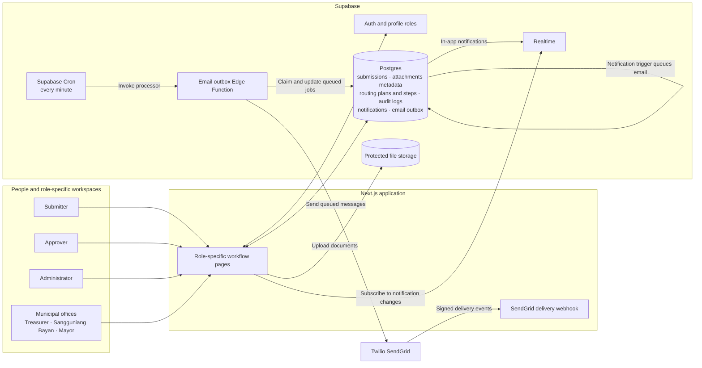
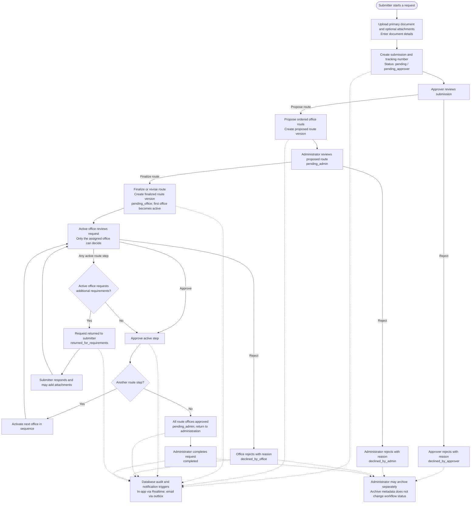

# CONNECT-Daet Workflow Architecture

The diagrams below describe the current role-based document workflow and its
application, data, and notification components.

## Application architecture

## Document lifecycle

The approver-proposed route and administrator-finalized route are versioned.
The Mayor's Office is optional and, when included, must be the final route step.
Office approvals advance one step at a time; any active office can request more
information. That pauses the route until the submitter responds, then returns it
to the requesting office's active step. The final approval returns the submission
to the administrator for completion.

Finalized route steps retain each office's assignment, decision, comments, and
decision time. Office dashboards keep these documents in the office history after
the active assignment moves to another office, while decision permissions remain
limited to the currently assigned office.

Role-based document lists show the shared visual routing pipeline in a compact,
read-only form within each submission card or row. The pipeline combines the
submission status, current route version, and office-step decisions to show
completed, active, pending, rejected, and skipped stages. Document detail pages
retain full submission details and workflow history without the pipeline. The
pipeline does not display SLA countdowns or blockchain hashes because the
workflow does not currently store those values.

Document detail pages organize communication into Messages and Activity tabs.
The live per-document conversation lets the applicant, approvers,
administrators, and municipal offices assigned to current or prior finalized
route steps exchange messages and up to five private attachments per message.
Database access policies limit messages and attachments to authorized
participants. Read receipts are tracked per participant, and each new message
creates in-app notifications and queues email through the existing notification
outbox.

Notifications are recorded in the database. Inserts create in-app notifications
and queue email jobs; clients subscribe to notification and submission-status
changes, messages, attachments, and read receipts through Supabase Realtime. A
Supabase Cron job calls the protected email outbox Edge Function, which sends
pending jobs through Twilio SendGrid and records delivery attempts.

## Implementation references

- [Submission and office workflow schema](./supabase/migrations/20261105160000_implement_five_stage_document_workflow.sql)
- [Shared visual routing pipeline](./components/WorkflowRoutingPipeline.tsx)
- [Live document conversation](./components/DocumentMessaging.tsx)
- [Document messaging schema, access policies, and notifications](./supabase/migrations/20261108080000_add_document_messaging.sql)
- [Submitter document detail and route progress](./app/%28dashboard%29/workflow/user/file_registry/[id]/page.tsx)
- [Approver document detail and route progress](./app/%28dashboard%29/workflow/approver/file_management/[id]/page.tsx)
- [Administrator document detail and route progress](./app/%28dashboard%29/workflow/admin/submissions/[id]/page.tsx)
- [Optional legacy purpose and action fields](./supabase/migrations/20261106160000_make_submission_purpose_and_action_optional.sql)
- [Versioned route tables](./supabase/migrations/20261105230000_add_versioned_workflow_routing.sql)
- [Dynamic route decisions and workflow notifications](./supabase/migrations/20261106000000_enable_dynamic_workflow_routes.sql)
- [Office document history access](./supabase/migrations/20261106140000_preserve_office_document_history.sql)
- [Approver submission notifications](./supabase/migrations/20261106100000_restore_approver_submission_notifications.sql)
- [Requirements requests from any municipal office](./supabase/migrations/20261106110000_allow_offices_to_request_requirements.sql)
- [Email outbox](./supabase/migrations/20260925090500_add_email_notification_outbox.sql)
- [Submission status realtime updates](./supabase/migrations/20261106150000_enable_submission_status_realtime.sql)
- [Email outbox Edge Function](./supabase/functions/process-email-outbox/index.ts)
- [Supabase Cron schedule](./supabase/migrations/20261110033000_schedule_workflow_email_edge_function.sql)
- [SendGrid event tracking migration](./supabase/migrations/20261110032000_switch_workflow_email_to_sendgrid.sql)
