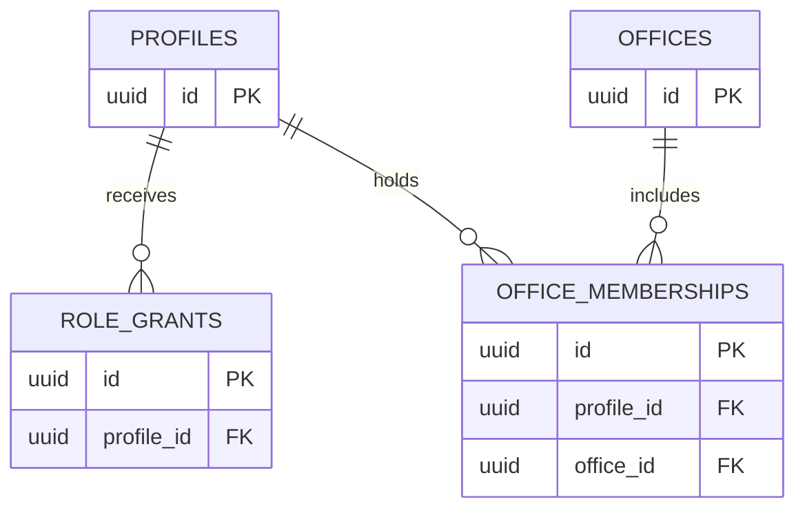
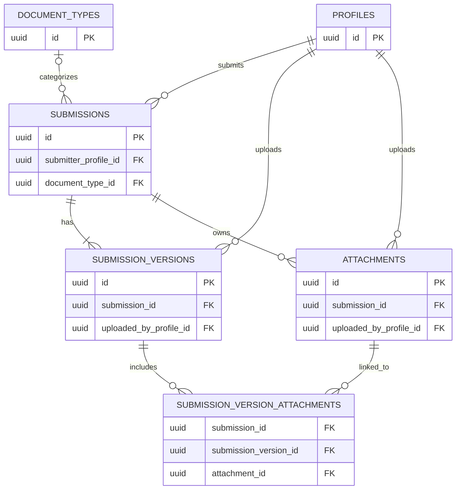
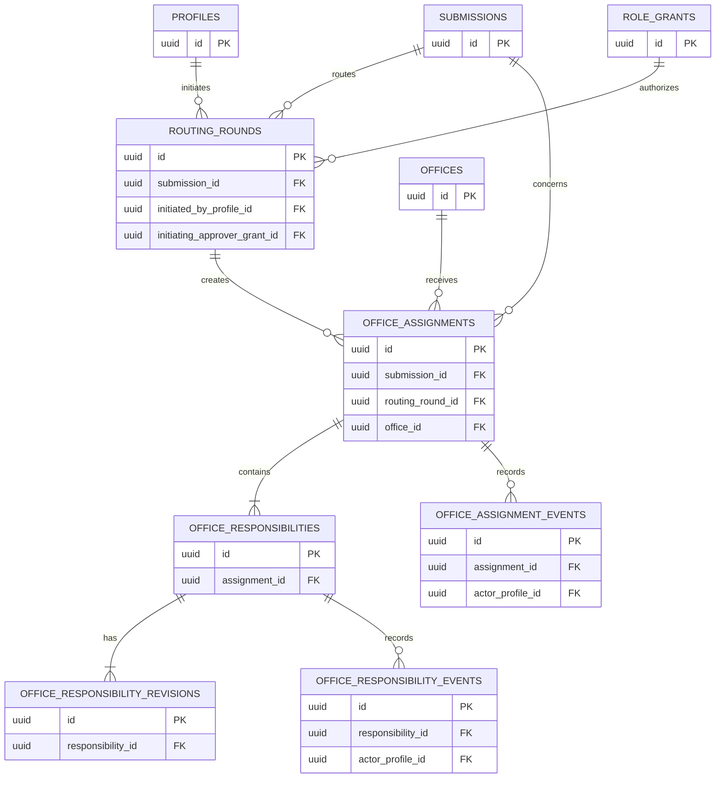
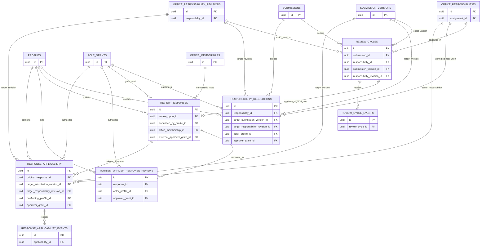
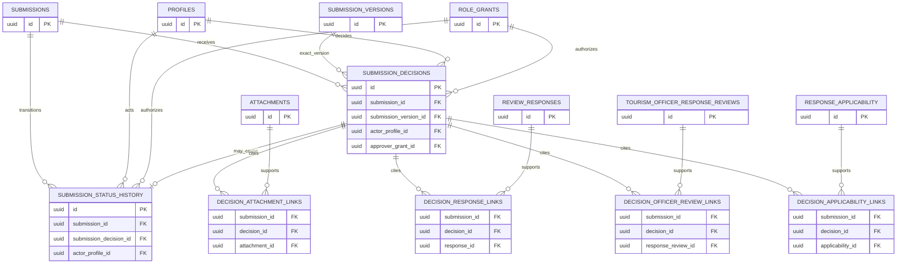
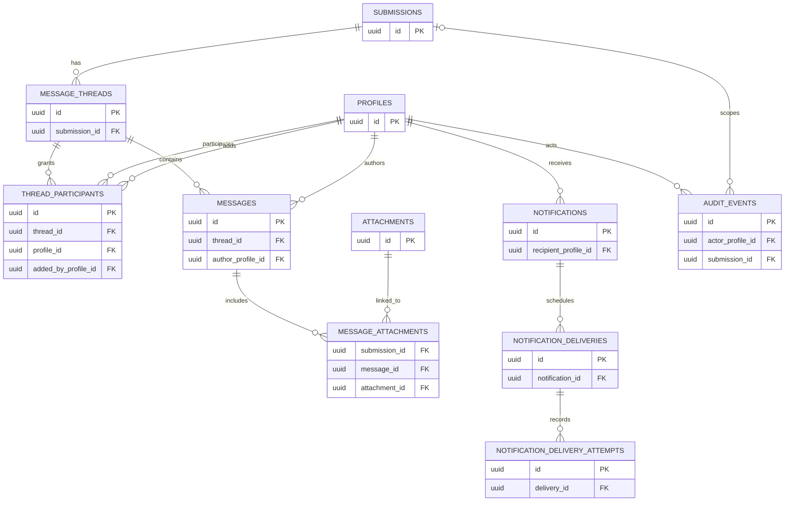

# Stage 3 — Relational Database Model and Integrity Specification

**Status:** Proposed working specification; not approved, implemented, or deployed  
**Workflow authority:** [Revised workflow plan](./REVISED_WORKFLOW_PLAN.md)  
**Related analysis:** [Phase 2 gap analysis](./PHASE_2_WORKFLOW_GAP_ANALYSIS.md), [implementation roadmap](./PHASE_2_IMPLEMENTATION_ROADMAP.md), and [workflow decision mapping](./PHASE_2_WORKFLOW_DECISION_MAPPING.md)

> This document is a relational design proposal. It does not describe the current hosted database or establish that any proposed entity exists. Existing Stage 3, 3.1, 3.2, or 3.3 documents were not found in the repository at the time of drafting. Do not generate or run SQL from this specification without review and explicit authorization.

## 1. Purpose and scope

Translate agreed workflow behavior into a proposed relational model that can preserve actor attribution, responsibility-level outcomes, versions, reassessment history, overall decisions, and authorization context. The specification covers conceptual columns, keys, constraints, indexes, and transaction boundaries. It does not choose a final migration path or implement RLS, functions, triggers, or Storage policies.

Labels used below:

- **Agreed workflow:** behavior established by the workflow plan or the current architecture instructions.
- **Recommended design:** a technical proposal to support that behavior.
- **Open policy:** an institutional decision that must not be encoded by assumption.
- **Implementation requirement:** a property that must be enforced later by a database operation and authorization controls.

## 2. Source documents and established assumptions

The canonical workflow document and Phase 2 documents were inspected. The workflow plan establishes the Tourism Officer-led process, Path A and Path B, simultaneous and one-at-a-time routing, three responsibility types, mandatory approval safeguards, response review, reassessment, versions, audit, messages, notifications, and the distinction between overall workflow and office-level progress. The Phase 2 documents distinguish local repository findings from historical TEST inspection.

No Supabase connection, existing TEST database, or Production resource was accessed for this task. All statements about existing application/database implementation in the Phase 2 documents remain documentation evidence, not fresh verification.

### Established workflow assumptions

- Roles are `user`, `approver` (Tourism Officer), `external_approver` (authorized office representative), and `admin` (Tourism Head/System Administrator). Roles are additive.
- A person may belong to multiple offices. Multiple authorized Tourism Officers share a queue but act through individual authenticated identities.
- Every submission first reaches a Tourism Officer. The Officer controls office selection, responsibilities, routing mode, response review, reassessment, sender returns, and overall decisions.
- Offices respond only for assigned responsibilities and return responses to the Tourism Officer. Offices do not forward to other offices or formally return submissions to applicants.
- One office assignment may contain multiple responsibilities: `mandatory_approval`, `evaluation`, and `recommendation`.
- A mandatory approval is satisfied only by an approved official response from the assigned office. Cancellation or generic resolution cannot bypass it.
- Negative evaluation/recommendation results are not automatic vetoes.
- Reassessment preserves earlier responses and decisions. Reuse requires explicit Tourism Officer applicability confirmation.
- Tourism Officer response-review actions and overall decisions are separate from office responses.
- Restricted Admin document/message access is not inferred from the `admin` role.
- Offline approval evidence and Storage policy changes are deferred.

### Established project-design decisions

The following are accepted working decisions for this project specification. They are **not evidence of formal MTO approval** unless separately documented as such.

- **Final-review gate:** Every active responsibility must have an official response, or a valid permitted resolution where that responsibility may be resolved without a response, before final review. Mandatory Approval / Clearance requires an approved official response from the assigned office. Evaluation and Recommendation require responses and cannot be satisfied by substituting a resolution; negative outcomes are not automatic vetoes. A legitimately cancelled responsibility is excluded only when mandatory safeguards are satisfied.
- **Response granularity:** The relational design uses one official response per responsibility review cycle. An office assignment is a container for independent responsibilities, not the single response record for all of them. Each cycle binds exactly one submission, submission version, logical responsibility, and responsibility revision; it receives at most one response.
- **Shared office queue:** Authorized active members may see their office’s relevant assignment. One member submits the official response for a cycle; after submission, other members are read-only for that cycle. Different responsibility cycles may have different submitting representatives.
- **Optional batching:** The interface may later group cycle-level responses for convenience. No `response_batches` table is assumed or required by this specification.

These are working project-design decisions. The canonical plan remains authoritative; its inconsistent wording is recorded in Section 21 for separate harmonization, and this document does not claim MTO approval.

## 3. Relational design principles

1. Use UUID primary keys for internal entities. Keep any human-readable tracking number separate; its format and scope remain open.
2. Use `timestamptz` for instants. Use explicit actor references for consequential actions.
3. Keep permanent submission identity separate from immutable submission versions.
4. Model role grants and office memberships as additive, historical relationships rather than a single mutable role/department field.
5. Keep office assignment as a container; responsibility is the unit of classification, response, readiness, and reassessment.
6. Preserve domain history in domain records/events. Generic audit events complement, but do not replace, submission status history or assignment/responsibility lifecycle history.
7. Prefer typed foreign-key relationships over polymorphic `(type, id)` references.
8. Use `jsonb` only for genuinely flexible, non-authoritative metadata. Do not use it to replace responsibility, response, actor, evidence, or authorization relationships.
9. Keep current-state projections, if used for queue performance, transactionally consistent with append-only history.
10. Enforce access in database/backend controls. UI filtering is not authorization.
11. Do not infer rejection criteria, status enums, retention policy, notification recipients, or other unresolved policy values.

## 4. Identity and office model

Supabase Auth remains the source of authenticated identity. A profile is the application-facing record keyed to the Auth identity. One person may have multiple role grants and office memberships without separate accounts.

### `profiles` — core

- **Primary key:** UUID profile ID corresponding to the authenticated identity.
- **Proposed columns:** `id`; profile attributes required by the application; `created_at`; `updated_at`.
- **Required:** `id`, creation timestamp. Other profile fields depend on product requirements.
- **Foreign keys:** `id` to the Auth identity, managed according to the chosen Supabase integration.
- **History/access:** Do not use mutable profile attributes as the historical record of authority. Access to personal profile details is scoped.

### `role_grants` — core

Use `role_grants` rather than a single-valued role column. This is a recommended historical grant model.

- **Proposed columns:** `id`; `profile_id`; `role_key`; `granted_by_profile_id`; `granted_by_admin_grant_id` where appropriate; `granted_at`; `revoked_at`; `revoked_by_profile_id`; `revocation_reason`.
- **Role values:** The agreed role names are `user`, `approver`, `external_approver`, `admin`. They may be represented by a constrained text/reference model; exact enum implementation is not selected.
- **Required:** profile, role, grant time, grantor for privileged grants.
- **Constraints:** Only authorized administration can grant/revoke privileged roles. Prevent duplicate active grants for the same profile/role. Ordinary registration grants submitter capability only.
- **History:** Revocation ends a grant; it does not delete it. Historical actions keep a reference to the grant used.

### `offices` — core

- **Proposed columns:** `id`; approved office identifier/name; active/inactive lifecycle fields; creation/update timestamps.
- **Required:** stable ID and administrative identity.
- **History/access:** Deactivation does not delete historical assignment or membership relationships.

### `office_memberships` — core

- **Proposed columns:** `id`; `profile_id`; `office_id`; `granted_by_profile_id`; `granted_by_admin_grant_id`; `started_at`; `ended_at`; `ended_by_profile_id`; `end_reason`.
- **Constraints:** At most one active membership per profile-office pair. Membership history remains after revocation.
- **Authorization:** A membership is necessary but not sufficient for an office response; the person must also hold an active `external_approver` grant and be authorized for the specific assignment/responsibility.

## 5. Submission and document model

### `submissions` — core

- **Primary key:** UUID `id`.
- **Proposed columns:** `id`; `submitter_profile_id`; optional `document_type_id`; optional human-readable tracking number; current-version reference if needed as a projection; timestamps; current lifecycle projection only if transactionally maintained.
- **Required:** ID, submitter, creation time.
- **Foreign keys:** Submitter to profile; optional type to `document_types`.
- **Composite integrity:** If a current-version pointer is retained, require `(submission_id, current_version_id)` to reference a version belonging to that same submission. A null pointer may be needed only during creation; transaction completion must establish the first version.
- **History/access:** Submission identity is permanent. Do not delete it as a workflow action. Submitter visibility is limited to owned submissions; Officer visibility follows authorized duties.

### `submission_versions` — core

- **Proposed columns:** `id`; `submission_id`; version number; `uploaded_by_profile_id`; `created_at`; version-level description/metadata only where required.
- **Constraints:** Unique version number per submission; each version belongs to exactly one submission. Versions are immutable after use in a review cycle.
- **History:** A correction creates a new version. Never replace a prior version’s file or data in place.

### `document_types` — optional

A catalog may support user selection and form validation. It must not automatically route a submission. Type-specific fields and rules are not settled.

### `attachments` and `submission_version_attachments` — core relationship

- `attachments` stores file metadata/reference, owning `submission_id`, `uploaded_by_profile_id`, creation timestamp, and necessary source/context metadata.
- `submission_version_attachments` links an attachment to a version and carries `submission_id` for same-submission validation.
- Use composite references so the version and attachment both belong to the stated submission.
- Actual Storage access, offline evidence, bucket design, and policies are outside scope and remain deferred.

## 6. Routing and responsibility model

### `routing_rounds` — core

- **Proposed columns:** `id`; `submission_id`; round sequence or identifier; routing mode (semantic choice of simultaneous or one-at-a-time); `initiated_by_profile_id`; `initiating_approver_grant_id`; `created_at`; reason/context.
- **Constraints:** Unique round sequence per submission if a sequence is used. A routing round is an explicit Tourism Officer action, not an automatic rule.
- **History:** Adding offices during simultaneous work may create additional assignment records in the active round or a subsequent explicit round; the exact representation is technical design, not new workflow policy.

### `office_assignments` — core

- **Proposed columns:** `id`; `submission_id`; `office_id`; `routing_round_id`; instructions; creator profile and approver grant; created timestamp; current lifecycle projection only if maintained transactionally.
- **Relationships:** One assignment names one office and contains one or more responsibilities. The assignment is a container, not the single response record for all its responsibilities.
- **Composite integrity:** `(submission_id, routing_round_id)` must identify a round for that same submission.
- **Lifecycle:** Assignment cancellation is an attributed event and cannot erase responsibilities or bypass a mandatory requirement.
- **Recommended default:** At most one active assignment per office per submission, with multiple responsibilities inside it. Multiple concurrent assignments to the same office remain an unresolved decision; if later approved, distinguish them by scope/round and adjust the uniqueness rule deliberately.

### `office_assignment_events` — core history

Record assignment creation, modifications, cancellation, and other authorized lifecycle actions. Proposed fields: event ID, submission/assignment IDs, event kind (conceptual), actor profile, `approver_grant_id`, timestamp, reason, and affected revision/context. Assignment-specific events are justified because cancellation and modification history determine whether work is active and whether mandatory safeguards apply. Generic audit events alone do not provide this domain state machine.

### `office_responsibilities` — core

- **Proposed columns:** `id`; `submission_id`; `assignment_id`; stable responsibility key/sequence if needed; creation actor/grant/time.
- **Constraints:** Each belongs to exactly one assignment. Type and mutable scope live in immutable revisions, not a mutable field that obscures historical classification.
- **History:** A responsibility is independently tracked even when several share an assignment.

### `office_responsibility_revisions` — core

- **Proposed columns:** `id`; `submission_id`; `assignment_id`; `responsibility_id`; revision number; responsibility type; scope/instructions; actor profile; `approver_grant_id`; timestamp; reason.
- **Constraints:** Unique revision number per responsibility. Revision type is one of the agreed types; exact storage mechanism is not prescribed.
- **History:** Immutable. Any legitimate change appends a revision and lifecycle event.

### `office_responsibility_events` — core history

Record creation, modification/revision, reassessment initiation, valid cancellation, resolution, and supersession where applicable. Proposed fields: event ID; submission, assignment, and responsibility IDs; optional revision/cycle references; event kind; actor profile; `approver_grant_id`; timestamp; reason. This table provides structured lifecycle state; `audit_events` records cross-system audit correlation.

### `responsibility_resolutions` — conditional core

Use only if a valid resolution must exist independently from an office response. Proposed fields: ID; submission, responsibility, revision, and target version references; resolution kind (not an invented enum); Officer actor and grant; reason; timestamp; invalidation/supersession linkage if needed.

Permitted use is limited to explicitly valid cases, especially nonmandatory responsibilities. A generic resolution cannot satisfy mandatory clearance. Mandatory approval requires an approved response from the assigned office. Cancellation before a blocking issue is distinct from resolution; exceptional mandatory cancellation is prohibited unless a policy is approved.

## 7. Review-cycle and response model

### `review_cycles` — core

- **Proposed columns:** `id`; `submission_id`; `assignment_id`; `responsibility_id`; `submission_version_id`; `responsibility_revision_id`; cycle sequence; creator profile; `approver_grant_id`; created timestamp; optional current-status projection.
- **Exact target:** Every cycle references exactly one submission version and one responsibility revision, and both must match the cycle’s submission, assignment, and logical responsibility.
- **Office queue behavior:** The shared queue exposes relevant assignments to authorized active office members. Each response is submitted by one authorized member for its specific cycle; after submission, other members are read-only for that cycle. A different cycle in the same assignment may have a different authorized representative.
- **Lifecycle history:** `review_cycle_events` is recommended as explicit append-only history. It records creation, response receipt, Officer review pending, clarification/follow-up, completion/resolution, and supersession as semantic event kinds, with actor/grant, time, reason, and affected cycle. These are not final enum values.
- **Current status:** If a status projection is stored, update it in the same transaction as the event and prevent direct edits that bypass the lifecycle operation.
- **Active-cycle rule:** Prevent overlapping active cycles for the same `(responsibility_id, target_submission_version_id, target_responsibility_revision_id)` using a partial uniqueness mechanism only after the semantic definition of “active” is approved. A transaction-controlled check is also required because cycle states and applicability/resolution bases interact.

### `review_responses` — core

- **Proposed columns:** `id`; `submission_id`; `review_cycle_id`; `responsibility_id`; `responsibility_revision_id`; `submission_version_id`; `submitted_by_profile_id`; `office_membership_id`; `external_approver_grant_id`; responsibility-level official outcome/findings; remarks; submitted timestamp.
- **Recommended cardinality:** One official response per responsibility review cycle. The response retains the exact cycle, target submission version, target responsibility revision, representative profile, office membership used, authorization role grant used, official outcome, and timestamp.
- **Constraints:** Unique response per `review_cycle_id`; do not add an assignment-wide unique response constraint. Composite FKs should ensure all cycle/responsibility/version/revision/submission references agree.
- **Authorization context:** On submission, verify the membership belongs to the actor and assignment office, was active at the response timestamp, and the actor held the required external-approver grant. Retain the exact membership and grant references after revocation.
- **History:** Immutable official response. Follow-up requires a new review cycle and response.
- **Optional batching:** No response-batch table is required. If a future interaction requirement groups several responses into one submit action, the batch may be an interface/orchestration concept or a separately approved envelope. Each child response remains cycle-specific and retains its own actor and authorization context. Readiness counts the child response once, never both a batch and its child. A single representative submitting an entire batch is not assumed; that operational rule remains for MTO confirmation if batching is pursued.

### `review_cycle_events` — core history

Proposed fields: event ID; submission, cycle, responsibility, version, and revision IDs; semantic event kind; actor profile; applicable role-grant or membership context; timestamp; reason/context. The event must reference the exact cycle and cannot retarget it.

### `review_response_attachments` — phased feature

Typed association between a response and attachment, carrying `submission_id` to validate common ownership. Do not change offline evidence or Storage policy.

### `tourism_officer_response_reviews` — core

Append-only actions: response ID; submission ID; actual Officer profile; `approver_grant_id`; disposition; reason/notes; timestamp. Multiple review actions may refer to one response. Clarification does not overwrite prior reviews.

## 8. Applicability and reassessment model

### `response_applicability` — core

Fields: ID; `submission_id`; original response ID; target submission-version ID; target responsibility-revision ID; logical responsibility ID; confirming Officer profile; `approver_grant_id`; reason; confirmation timestamp.

The original response retains its original cycle/version/revision. Composite relationships must ensure the response and target are for the same submission and logical responsibility. The Tourism Officer explicitly confirms applicability. Do not infer material equivalence from matching identifiers. If applicability is uncertain or the requirement materially changed, reassessment is the safer path.

Prevent more than one active applicability confirmation for the same target responsibility context. Because an effective basis may also be a review response or resolution, exclusivity across these separate tables requires a transaction-controlled operation; independent unique indexes do not prove cross-table exclusivity.

### `response_applicability_events` — core history

Append-only invalidation/supersession events include confirmation ID, submission and target context, actor profile, `approver_grant_id`, timestamp, reason, and affected state. An incorrect confirmation is invalidated, not edited or reactivated. A later confirmation is a new record.

### Reassessment and effective basis

A reassessment creates a new cycle for a selected responsibility/version/revision and preserves all previous cycles/responses. For each target context, at most one basis may be effective: a current official response, a valid applicability confirmation, or an explicitly permitted resolution. Exclude superseded cycles and invalidated confirmations; do not count an original response a second time when applicability makes it effective for a new target.

Cross-table effective-basis exclusivity, supersession, and current outcome selection require a transaction-controlled operation. Do not claim ordinary uniqueness on separate tables enforces this invariant.

## 9. Overall decisions and lifecycle history

### `submission_decisions` — core

- **Proposed columns:** `id`; `submission_id`; exact `submission_version_id`; actual Officer profile; `approver_grant_id`; decision kind; decision stage/context; reason; correction instructions when returned; supporting context; timestamp.
- **Authority:** Only an authorized Tourism Officer may create an overall decision. Office responsibility outcomes must never be written here.
- **Semantics:** `returned` is nonterminal and repeatable. `approved` and `rejected` are terminal under the recommended no-reopening default. Rejection reasons are required by the workflow; exact criteria remain open. Final approval requires the responsibility readiness guards.
- **Terminal safeguard:** A partial unique index or equivalent controlled invariant should allow at most one terminal approved/rejected decision per submission under the no-reopening default. The decision operation must lock/check the submission and append decision/status/audit records atomically. Reopening remains unresolved and would require an explicit future decision-episode model.
- **COMPLETED/WITHDRAWN:** Preserve as unresolved lifecycle-policy questions; do not silently map them to decision outcomes or remove them.

### `submission_status_history` — core

Authoritative historical record of submission lifecycle transitions, whether or not a transition was caused by an overall decision.

- Proposed fields: ID; `submission_id`; transition meaning; timestamp; actor profile; applicable role-grant reference; nullable `submission_decision_id`; controlled non-decision cause reference; reason/context.
- A decision-related transition references the relevant decision. A non-decision transition uses an approved controlled cause representation, not an unrestricted polymorphic pointer.
- If an event has a nullable decision link, a separate constrained cause field/category is required when the link is null. The exact transition vocabulary remains unresolved.
- Current submission status, if stored, is a projection updated atomically with the history row.

## 10. Messaging and notification model

These features may be phased without weakening core routing, response, and decision behavior.

- **`message_threads`:** Submission-scoped discussion context with explicit visibility purpose.
- **`thread_participants`:** Thread, profile, added-by actor, participation basis, effective start, end/revocation time, and removal reason. Membership and assignment checks remain prerequisites; thread participation is additional access scope, not independent authority. Historical visibility for newly added participants is a policy decision.
- **`messages`:** Thread, author, content, timestamp. Preserve authorship/history; Admin role alone does not grant message-content access.
- **`message_attachments`:** Typed message/attachment relationship with same-submission validation.
- **`notifications`:** Recipient and workflow event reference, creation/read state.
- **`notification_deliveries`:** Notification, channel, processing state and retry scheduling.
- **`notification_delivery_attempts`:** Append-only attempts and safe error metadata.

Exact event-recipient-channel-timing rules and retention remain open. Do not include offline evidence or Storage policy redesign.

## 11. Audit and idempotency model

### `audit_events`

Cross-system record of consequential actions, including actions without a submission status transition. Proposed fields: event ID; actor profile; role-grant/membership context where relevant; event kind; timestamp; optional submission and domain-record references; correlation/idempotency reference; minimal context.

Domain-specific event tables remain authoritative for assignment, responsibility, review-cycle, applicability, and status history. Avoid an unconstrained polymorphic reference as the only evidence of a workflow mutation. Record required business history and audit event in the same transaction.

### `idempotency_keys`

Proposed fields: ID; authenticated actor; operation scope; key; canonical request fingerprint; processing/completed state; safe result reference; created/updated timestamps; optional expiry metadata.

- Uniqueness is scoped to actor, operation, and key.
- Same key and same fingerprint returns the safe prior result.
- Same key with a different fingerprint is rejected.
- Processing state prevents concurrent duplicate operations.
- Define safe recovery for interrupted operations and an approved expiration/cleanup policy before implementation.
- Do not retain sensitive request payloads unnecessarily.

### `system_settings` — optional

Limit to approved non-security-critical configuration. Generic settings must not modify privileged authorization, Officer authority, RLS behavior, or mandatory workflow guards. Sensitive settings require a separate controlled and audited path.

## 12. Entity inventory and table specifications

The detailed purpose, proposed columns, and key relationships are specified in Sections 4–11. This summary distinguishes primary keys and principal constraints; names and types remain proposals.

| Entity | PK | Principal required fields / relationships | History and authorization |
|---|---|---|---|
| `profiles` | UUID | Auth identity reference | Profile visibility scoped; Auth remains identity source. |
| `role_grants` | UUID | profile, role, grantor, grant time | Append grant/revocation; admin authorization. |
| `offices` | UUID | stable office identity | Deactivation preserves references. |
| `office_memberships` | UUID | profile, office, start, grantor | End rather than delete; active membership uniqueness. |
| `submissions` | UUID | submitter, optional type/tracking ID | Permanent identity; scoped access. |
| `submission_versions` | UUID | submission, version number, uploader, time | Immutable; unique per submission/version. |
| `document_types` | UUID | type metadata | Optional; no automatic routing. |
| `attachments` | UUID | submission, uploader, file metadata | Provenance retained; Storage deferred. |
| `submission_version_attachments` | UUID or composite | submission, version, attachment | Typed same-submission link. |
| `routing_rounds` | UUID | submission, mode, Officer, approver grant, time | Explicit Officer action history. |
| `office_assignments` | UUID | submission, office, routing round | Assignment container; Officer controlled. |
| `office_assignment_events` | UUID | assignment, actor/grant, event, reason, time | Append-only lifecycle history. |
| `office_responsibilities` | UUID | submission, assignment, stable identity | Independent readiness/outcomes. |
| `office_responsibility_revisions` | UUID | responsibility, revision, type, scope, actor/grant | Immutable; unique revision number. |
| `office_responsibility_events` | UUID | responsibility, assignment, actor/grant, event, reason | Append-only lifecycle history. |
| `responsibility_resolutions` | UUID | responsibility, target version/revision, Officer/grant, reason | Conditional; cannot satisfy mandatory approval. |
| `review_cycles` | UUID | submission, responsibility, exact version/revision, creator/grant | At most one active cycle per target context. |
| `review_cycle_events` | UUID | cycle/context, actor authorization context, event, time | Append-only status lifecycle. |
| `review_responses` | UUID | cycle, actor, office membership, external role grant, outcome, time | One per cycle; immutable. |
| `review_response_attachments` | UUID or composite | submission, response, attachment | Optional typed same-submission link. |
| `tourism_officer_response_reviews` | UUID | response, Officer/grant, disposition, reason, time | Append-only; multiple per response. |
| `response_applicability` | UUID | original response, exact target, Officer/grant, reason, time | Explicit and target-specific. |
| `response_applicability_events` | UUID | confirmation, actor/grant, event, reason, time | Append-only invalidation/supersession. |
| `submission_decisions` | UUID | submission, exact version, Officer/grant, kind/context, reason/time | Append-only; terminal uniqueness under default. |
| `submission_status_history` | UUID | submission, transition, actor/context, optional decision, cause | Authoritative lifecycle history. |
| Typed decision evidence links | UUID or composite | decision, submission, typed source record | Same-submission integrity; no polymorphic-only link. |
| `message_threads` | UUID | submission, visibility purpose | Optional; access scoped. |
| `thread_participants` | UUID | thread, profile, adding actor, basis, start/end | Historical grants/revocation. |
| `messages` | UUID | thread, author, content, time | Append-preserving; participant access. |
| `message_attachments` | UUID or composite | submission, message, attachment | Typed same-submission link. |
| `notifications` | UUID | recipient, event reference, time | Optional/phased. |
| `notification_deliveries` | UUID | notification, channel, state | Retryable. |
| `notification_delivery_attempts` | UUID | delivery, attempt time/result | Append-only. |
| `audit_events` | UUID | actor/context, action, time, correlation | Restricted, append-only. |
| `idempotency_keys` | UUID | actor, operation, key, fingerprint, state/result | Scoped unique key and safe retry. |
| `system_settings` | UUID or key | approved noncritical setting, modifier/time | Optional and constrained. |

**Type recommendations:** UUID identifiers; `timestamptz` instants; bounded text or approved references for labels; structured columns for relationships and state. Use `jsonb` only for extensible descriptive metadata that is not relied on for authorization, uniqueness, joins, or workflow invariants. Exact enums, lifecycle labels, and field nullability require schema review.

## 13. Relationship/cardinality matrix

| Parent → child | Cardinality | Required consistency |
|---|---|---|
| Profile → role grants / memberships | One-to-many each | Historical actor attribution retained. |
| Office → memberships / assignments | One-to-many each | Membership and assignment office IDs must agree for a response. |
| Submitter profile → submissions | One-to-many | Exactly one submitter per submission. |
| Submission → versions / routing rounds / assignments / decisions / status history | One-to-many | Children carry or resolve to same submission. |
| Version ↔ attachments | Many-to-many through typed link | Both records belong to the same submission. |
| Routing round → assignments | One-to-many | Round and assignment share submission. |
| Assignment → responsibilities | One-to-many | Each responsibility belongs to one assignment and submission. |
| Responsibility → revisions / events / cycles | One-to-many | Revision and cycle belong to same logical responsibility. |
| Responsibility → resolutions | One-to-many | Resolution targets same submission/responsibility/version/revision. |
| Cycle → version / revision | Many-to-one for each, exactly one each | Both match cycle’s submission and responsibility. |
| Cycle → response | One-to-zero-or-one | Unique cycle response. |
| Response → representative / membership / role grant | Many-to-one each | Profile, membership, office, and role authorization agree and were valid at action time. |
| Response → Officer reviews / applicability source records | One-to-many | Every action has actual Officer actor/grant. |
| Submission → decisions | One-to-many | Decision’s version belongs to that submission. |
| Decision → typed evidence | One-to-many per evidence type | Evidence source belongs to same submission; old response requires valid applicability for target version. |
| Thread ↔ profiles | Many-to-many through participants | Membership/assignment remains independently checked. |
| Notification → deliveries → attempts | One-to-many each | Attempt history preserved. |

## 14. Composite foreign-key requirements

Ordinary foreign keys prove existence, not that related records belong together. Carry `submission_id` (and where relevant assignment/responsibility IDs) in child rows and require composite candidate keys/FKs or equivalent transaction-controlled validation.

| Relationship | Composite integrity requirement |
|---|---|
| Submission and current version | `(submission_id, current_version_id)` references a version under that submission. |
| Submission and routing round | Round has unique `(submission_id, routing_round_id)` relationship. |
| Routing round and assignment | Assignment `(submission_id, routing_round_id)` references a round for the same submission. |
| Assignment and responsibility | Responsibility `(submission_id, assignment_id)` references that assignment. |
| Responsibility and revision | Revision `(submission_id, assignment_id, responsibility_id)` references the same responsibility/assignment. |
| Responsibility and cycle | Cycle carries submission, assignment, and responsibility identity and references that exact responsibility. |
| Cycle and target version | Cycle `(submission_id, submission_version_id)` references a version of that submission. |
| Cycle and target revision | Cycle `(submission_id, responsibility_id, responsibility_revision_id)` references a revision of that responsibility in that submission. |
| Response and cycle | Response’s cycle and repeated submission/responsibility/version/revision references agree; enforce with composite FK or transaction validation. |
| Response actor authorization | Response’s profile and membership refer to the same person; membership office equals assignment office; external-approver grant belongs to the actor. Time-validity is transactional, not an ordinary FK. |
| Attachments and version/workflow links | Every typed link includes submission ID and references source and attachment from that submission. |
| Decision and evidence | Decision and evidence source share submission; cross-table source checks require typed links and transactional validation. |
| Applicability target | Original response and target version/revision belong to same submission and logical responsibility. |

Do not introduce a generic polymorphic evidence or lifecycle reference as a substitute for these relationships.

## 15. Unique and check constraints

| Invariant | Recommended mechanism | Notes |
|---|---|---|
| Active role grants | Partial unique index on profile/role where active | Grantor authorization is transactional. |
| Active office membership | Partial unique index on profile/office where active | History remains after end time. |
| Submission version numbering | Unique `(submission_id, version_number)` | Allocate sequence transactionally. |
| Routing-round numbering | Unique `(submission_id, round_number)` if numbering is used | Round semantics are technical; no tracking-number policy implied. |
| Active assignments | Recommended partial unique `(submission_id, office_id)` where active | Recommended default only; concurrent same-office assignments remain open. |
| Responsibility revision numbering | Unique `(responsibility_id, revision_number)` | Revision is immutable. |
| Active review cycles | Conditional unique target context for approved active statuses | Requires settled active-state definition; transaction also checks applicability/resolution exclusivity. |
| One response per cycle | Unique `review_cycle_id` | Prevent duplicate official response. |
| Applicability duplicates | Conditional unique target responsibility context for active confirmations | Cross-table effective-basis exclusivity still requires transaction. |
| Resolution validity | Local checks for required actor/reason fields; cross-table transaction validation | Must prohibit mandatory satisfaction by generic resolution. |
| Terminal overall decision | Conditional unique terminal decision per submission | Recommended no-reopening default; returns remain multiple. |
| Thread participants | Unique active `(thread_id, profile_id)` | Access also requires current submission/office authorization. |
| Idempotency | Unique actor/scope/key | Fingerprint mismatch rejects reuse. |
| Responsibility type | Check/reference for the three agreed labels | Does not define outcome/status vocabulary. |
| Timestamp ordering | Local checks where meaningful | Event ordering and validity windows may need transaction validation. |

**Local checks versus cross-table rules:** CHECK constraints are appropriate for local field shape (e.g. required actor/reason combinations or valid responsibility type). They cannot by themselves verify current roles, membership time validity, same-submission relationships across multiple tables, mandatory clearance readiness, terminal-state transitions, or cross-table effective-basis exclusivity. Those require composite foreign keys where possible and transaction-controlled operations plus RLS authorization.

## 16. Index specification

Add indexes based on queue/filter/join patterns, then validate with representative query plans. Do not index every column.

| Query path | Essential index candidates |
|---|---|
| Submitter submission list | `(submitter_profile_id, created_at DESC)` on submissions. |
| Tourism Officer workflow queue | Submission lifecycle projection plus creation/priority ordering; cycle/action lookup by status and created time. Exact filter fields depend on selected state model. |
| Office assignment queue | `(office_id, lifecycle/current-state, created_at)` on assignments, plus active membership lookup `(profile_id, office_id, ended_at)`. |
| Responsibility readiness | `(submission_id, assignment_id)` responsibilities; `(responsibility_id, created_at)` cycles; target-context composite index over responsibility/version/revision and active projection. |
| Review-cycle history | `(responsibility_id, created_at)` and `(submission_id, created_at)` on cycles/events. |
| Version history | Unique `(submission_id, version_number)` also supports submission version lookup. |
| Decision/status history | `(submission_id, created_at)` on decisions and status history. |
| Notifications | `(recipient_profile_id, read_at, created_at DESC)` or equivalent unread/recipient query index. |
| Messages | `(thread_id, created_at)`; participant lookup `(profile_id, thread_id, ended_at)`. |
| Audit lookup | `(submission_id, created_at)` where submission-scoped; actor/time and event/time indexes only for expected investigations. |
| Idempotency lookup | Unique actor/scope/key index. |
| Applicability | Target-context lookup `(responsibility_id, target_submission_version_id, target_responsibility_revision_id)` with active-state condition. |

Foreign-key columns used for joins/deletes/authorization should be indexed where the database does not provide suitable indexes automatically. Avoid speculative indexes on low-selectivity or rarely queried fields.

## 17. Effective-basis and readiness invariants

For each logical responsibility and target context `(responsibility_id, target_submission_version_id, target_responsibility_revision_id)`, no more than one basis may be effective:

1. Current official response from a valid, non-superseded cycle.
2. Valid Tourism Officer applicability confirmation of a prior response.
3. Explicitly permitted resolution for a responsibility type where resolution is allowed.

These sources reside in different relations; ordinary unique indexes on each table cannot enforce mutual exclusivity. A transaction-controlled operation must lock/check the target responsibility context, validate all candidate sources, deactivate/supersede any previous basis with history, and commit exactly one effective basis.

Before final review, every active responsibility has an official response, or a valid permitted resolution only where the responsibility is allowed to be resolved without a response. A legitimately cancelled responsibility is excluded only when mandatory safeguards are satisfied. Mandatory responsibilities require approved official responses from their assigned offices; a denied or unresolved mandatory clearance cannot be cancelled or generically resolved to enable approval. Evaluation and recommendation require responses and cannot be satisfied by substituting a resolution; negative results are not automatic vetoes.

The readiness calculation is per responsibility, never per assignment alone. If optional batch submission is introduced, calculate readiness from the individual cycle responses, not from both a batch envelope and its children.

## 18. Transaction and concurrency requirements

All listed operations must authorize the actual actor, validate current state, append domain history and required audit/status history atomically, update any current-state projection, and roll back completely on failure.

| Operation | Authorization and checks | Records/events and projection | Concurrency/idempotency |
|---|---|---|---|
| Create submission + initial version | Authenticated submitter; required fields | Insert submission, first version, attachment links, status history/audit as required | One transaction; retry-safe submission key. |
| Resubmit new version | Owner and current correctable state | Add immutable version/links; append lifecycle/status history | Lock/check submission version/state; idempotency key. |
| Create routing rounds/assignments | Active Tourism Officer grant | Round, assignments, responsibilities/revisions, events, audit | Lock or compare submission state; validate same office/round constraints. |
| Add office during simultaneous work | Tourism Officer and active simultaneous-processing context | New assignment/responsibilities/events | Recheck round/submission active state; idempotency; avoid duplicate active office assignment per chosen policy. |
| Submit official response | Active external role grant, active exact office membership, assigned office/responsibility | One response, attachments, cycle event, audit | Unique response per cycle; conflict on concurrent submit; membership valid at action time. |
| Request clarification | Tourism Officer grant and response review context | Append Officer review action and cycle event; notify via approved flow | Serialize with response/cycle state; no update to old response. |
| Start reassessment | Tourism Officer; selected responsibility and target version/revision | New cycle and event; mark old context superseded if applicable | Prevent overlapping active cycles; idempotent retry. |
| Confirm applicability | Tourism Officer; same submission/responsibility; explicit reason | Confirmation and event/audit | Lock target context; reject if another basis active or requirement materially changed; no silent reactivation. |
| Resolve nonmandatory responsibility | Tourism Officer; permitted responsibility type and valid reason | Resolution/event/audit; projection update | Lock responsibility; prohibit mandatory bypass; idempotency. |
| Make overall decision | Tourism Officer; readiness checks for approval, reason/context for rejection/return | Decision, status history, audit, notification request | Serialize per submission; enforce one terminal decision under default; returns repeatable. |
| Update lifecycle status | Authorized cause/actor | Status history and projection | Same transaction, transition validation; never direct inconsistent projection update. |
| Grant/revoke role | Authorized admin grant | Append grant/revocation and audit | Lock grant scope; active uniqueness; idempotency. |
| Grant/end office membership | Authorized admin grant | Append membership lifecycle and audit | Lock profile-office pair; active uniqueness; revocation immediately affects future access. |

Rollback must leave no partial business mutation, history gap, orphaned link, or “success-shaped” current-state projection.

## 19. Optional feature assessment

**Core for first coherent workflow:** identity/role grants, offices/memberships, submissions/versions, routing, assignments/responsibilities/revisions/events, cycles/events/responses, Officer response reviews, applicability, overall decisions, status history, and audit.

**Can be phased without weakening core workflow:**

- **Document types:** Optional catalog; no automatic routing.
- **Response batching:** Optional future interaction feature, not a required relational entity. If a grouped submission action is later needed, it must group individual cycle-level responses without changing their responsibility/version/revision links or actor context. Whether one representative must submit the whole group remains an MTO workflow question.
- **Office suggestions:** Keep as response content unless structured tracking is approved.
- **Messaging:** Can be phased, but when enabled must enforce participant scope and not grant authority.
- **Notification delivery tracking:** Can be phased in channel breadth; retryable delivery and audit expectations should be preserved when email/in-app notification is enabled.
- **System settings:** Optional and limited to non-security-critical configuration.
- **Responsibility resolution:** Use a separate table only if valid nonmandatory resolution must be independently referenced as an effective basis. Otherwise, a typed responsibility lifecycle event may suffice, provided it cannot be confused with mandatory office approval and retains exact target context.
- **Attachments:** Core metadata/provenance relationships; actual Storage policies and offline evidence remain deferred.

Do not add entities solely to reach a target table count.

## 20. Unresolved institutional decisions

Keep the following open; the conceptual model must not silently decide them:

| Decision | Model accommodation |
|---|---|
| Meaning/timing of `COMPLETED` | Can be represented as a lifecycle transition separate from decision; semantics need approval. |
| Submission withdrawal | Can be a separate status-history cause; actor, timing, and consequences need approval. |
| Reopening terminal decisions | Recommended default is no reopening. Reopening needs approved decision-episode semantics and history. |
| Formal rejection criteria | Store required reason/context without encoding criteria. |
| Permitted nonmandatory resolutions | Resolution structure can support approved cases; allowed types/conditions need policy. |
| Conditions for responsibility cancellation | Lifecycle events preserve the action; valid timing and conditions need policy. |
| Definition of material document changes | Applicability can require explicit Officer confirmation; technical comparison criterion remains open. |
| Multiple concurrent assignments to same office | Recommended default one active assignment per office/submission; exceptions require approval. |
| Tracking-number format/scope | Store separately from UUID; format and allocation scope remain open. |
| Historical message visibility for new participants | Model supports effective start and explicit historical-access grant; policy choice remains open. |
| Retention periods | Append-only operational history is modeled; retention/archival/deletion policy remains open. |
| Reporting requirements | Can query domain histories; metrics and access require approval. |
| Exceptional mandatory cancellation | Prohibited absent authorized institutional rule; model must not enable bypass by default. |
| Notification recipient matrix | Delivery entities can support it; event/recipient/channel/timing remain open. |
| Office authority by requirement and legacy path meanings | Manual assignments are modeled; authority matrix and legacy labels require clarification. |
| Office-level statuses and valid resolutions | Semantic events are proposed; exact lifecycle values remain open. |
| Points eligibility and reversals | Can be added without affecting core workflow; policy unresolved. |
| Offline evidence and Storage policies | Explicitly deferred; no design or policy changes here. |

## 21. Risks, inconsistencies, and recommendations

### Workflow-plan wording to reconcile

The canonical workflow plan’s Path B step says final review follows satisfaction of all required mandatory assignments, while its final-review section requires every active responsibility to have a response or valid resolution and sets separate response requirements for all three responsibility types. The Path B sentence is incomplete or ambiguous relative to that explicit final-review rule. This specification uses the accepted project-design gate in Section 2; it does not weaken the gate or modify the canonical plan. Harmonize the Path B wording in a separately authorized documentation task. This working interpretation is not evidence of formal MTO approval.

The canonical plan says only one official decision is accepted for an active assignment, while also requiring multiple independently classified responsibilities and prohibiting one office-level decision from representing different outcomes. It does not specify response-record granularity. This specification recommends one official response per responsibility review cycle and treats an assignment as a container, not as the single response record for all responsibilities. The hierarchy is assignment → responsibility → revision/cycle → one official response. This is a recommended relational design, not an institutionally confirmed interpretation of the assignment-level sentence. Harmonize that sentence separately; do not add assignment-wide response uniqueness.

Batch submission is optional and does not change response granularity. If needed, a future batch action groups individual cycle-level responses; each remains independently attributable and readiness counts each child response once. Whether one representative must submit a whole batch is not decided.

### Main technical risks

- Composite same-submission consistency spans many relations and cannot be left to UI code.
- Cross-table effective-basis exclusivity cannot be enforced by independent unique indexes.
- Role revocation and membership termination must stop future actions while preserving historical authorization references.
- Status projections and append-only histories can diverge unless updated atomically.
- A generic resolution entity can accidentally bypass mandatory clearance without strict type and transaction guards.
- Terminal-decision uniqueness assumes the recommended no-reopening default; future reopening requires explicit redesign.
- Thread participation alone cannot authorize document or office access.
- Historical TEST findings and local migrations do not prove the target schema or deployed state.

### Recommendations

1. Harmonize the Path B and assignment-response wording in the canonical workflow plan through a separately authorized review; retain the accepted project-design gate and recommended cycle-level response model in this specification meanwhile.
2. Obtain MTO confirmation on how the canonical “one official decision per active assignment” wording should relate to independent responsibility outcomes and cycle-level response records. This specification’s response granularity remains a technical recommendation, not an institutional approval.
3. If batching is pursued, obtain MTO direction on whether one representative must submit all responses in a batch. Do not require a batch entity absent a concrete need.
4. Approve lifecycle semantics for active cycles, resolutions, valid cancellation, and terminal decisions.
5. Produce a reviewed relational diagram and same-submission constraint map before SQL design.
6. Design authorization context references and transactional operations alongside the schema, not after it.
7. Keep optional messaging, notification breadth, points, reporting, offline evidence, and Storage changes outside the core schema decision unless separately approved.

## 22. Readiness assessment

| Stage | Assessment | Reason |
|---|---|---|
| Working relational specification | **Ready for review, not approved.** | The entities, proposed columns, relationships, and integrity mechanisms are documented with unresolved items labeled. |
| Relational schema approval | **Not ready.** | Active-cycle semantics, resolution rules, concurrent same-office assignments, historical participant visibility, and reopening policy remain consequential. |
| SQL generation | **Not ready.** | Composite FK implementation, cross-table transactional invariants, RLS design, and operational migrations need separate design and approval. |
| Local migration testing | **Not ready.** | Requires an approved schema, data-preservation strategy, authorization plan, and isolated fixtures. |
| New hosted Supabase project | **Not ready.** | Requires explicit architecture/schema/security approval and separate project-creation authorization. |

Do not treat this specification or its diagrams as a finalized or deployed database design.

## Appendix A. Conceptual Mermaid ER diagrams

These diagrams visualize the relationships specified above; they do not add tables or finalize foreign keys. Solid relationships show required workflow relationships unless the accompanying note marks them provisional. Optional feature groups are explicitly labeled. Composite same-submission constraints and transactional cross-table checks remain as described in Sections 14–18 and cannot all be expressed by ER cardinality alone.

### A.1 Identity and organizational membership — core

Role grants and memberships are historical and additive. Active uniqueness and grantor/actor authorization are constraints described in Sections 4 and 15.

### A.2 Submissions, versions, and attachments — core

`DOCUMENT_TYPES` is optional. Attachments are submission-scoped; the version-attachment junction and composite integrity checks ensure linked records belong to the same submission. Storage access and offline evidence are outside this diagram and remain deferred.

### A.3 Routing rounds, assignments, and responsibilities — core

The diagram shows the assignment as a container that may hold multiple responsibilities. One active assignment per office/submission is only the recommended default; concurrent assignments to one office remain unresolved. Responsibility events preserve lifecycle history; cancellation does not bypass mandatory approval.

### A.4 Review cycles, responses, and applicability — core

Each cycle references exactly one submission version and one responsibility revision; those must match its submission and responsibility. The `||--o|` relationship means a cycle receives zero or one response, never more than one. There is deliberately no assignment-wide response uniqueness relationship. Reassessment adds cycles and responses; prior records remain. Applicability points to an old response and a specific target context without retargeting the original response. Effective-basis exclusivity across responses, applicability, and permitted resolutions requires transaction-controlled validation.

### A.5 Overall decisions, status history, and decision evidence — core

Only the Tourism Officer creates overall decisions. Office responses remain responsibility-level outcomes and are evidence for, not substitutes for, an overall decision. Status history remains authoritative for lifecycle transitions; a decision reference may be absent for non-decision transitions, which require a controlled cause. The four `DECISION_*_LINKS` names are descriptive placeholders for the typed evidence links already specified in Sections 9 and 14, not an approved set of table names. Same-submission integrity, including applicability to the exact target version/revision, requires composite references or transaction validation.

### A.6 Messaging, notifications, and audit — optional features plus core audit

Messaging and notification relationships are optional/phased. `audit_events` is part of the core integrity model; it complements rather than replaces domain-specific events and status history.

Thread participation is additional access scope, not independent authority. Current office membership and assignment authorization must still be checked. Attachment links must validate common submission ownership. The optional message-visibility rule for participants added later remains unresolved. Audit-to-domain-record correlation is intentionally not shown as a polymorphic ER relationship; domain event records remain authoritative.
